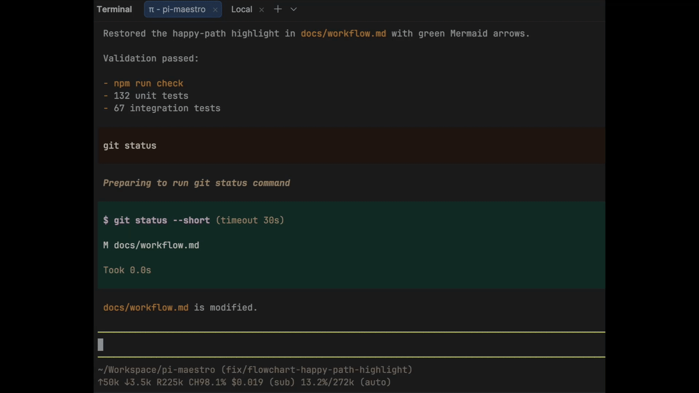

# pi-open-github-pr

A Pi extension that uses the agent to inspect committed changes, generate a pull request title and description, and open or update the GitHub Pull Request.



## Prerequisites

The current checkout must be a Git repository with an `origin` remote. The `git` executable and authenticated GitHub CLI (`gh`) must be available.

The extension supports macOS and Linux. Windows is not supported.

## Installation

Install the package in Pi with:

```bash
pi install npm:@emiliosp/pi-open-github-pr
```

## Usage

Load the extension in Pi, then run:

```text
/open-github-pr
```

Pi inspects the current branch and reads the committed diff. The agent then generates a concise pull request title and description, fills the [pull request template](templates/pull-request_template.md), and uses the dedicated tools to push existing commits and create or update the open Pull Request.
During the active workflow, agent Bash commands are blocked; the dedicated extension tools perform the repository operations.